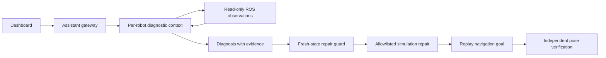

# Robot Debug Lab

English | [简体中文](README.zh-CN.md)

**An evidence-driven AI debugging lab for ROS 2 robots — no physical robot required.**

Each simulated robot gets an independent diagnostic context. An Assistant gateway coordinates reproduction, agent investigation, bounded repair, and verification against actual robot position. Model conclusions are linked to recorded observations, and a successful repair must pass the original navigation task again.

## Features

- Two real TurtleSim instances in isolated ROS namespaces: `robot_1` and `robot_2`.
- A custom Navigate Action and a deterministic 20 Hz velocity controller; the LLM is outside the real-time control loop.
- Three reproducible faults: stopped controller, misrouted velocity topic, and zero maximum speed.
- OpenAI-compatible tool calling, exercised with DeepSeek.
- Read-only investigation tools, evidence references, per-robot locks, and allowlisted repair operations.
- React dashboard with live trajectories, task cancellation, history, and JSON evidence export.
- Natural-language single/dual-robot goals, bounded clarification follow-ups, saved plan history, and refresh recovery.
- Direct model or OpenFang REST backend, with one-command service startup.
- An explicit offline rules baseline. Model failures never silently fall back to rules and masquerade as AI results.
- A pinned real-source Nav2 #5710 experiment: reproduce an ASan failure, ask OpenFang for a bounded C++ patch, rebuild it, and run six independent behavioral checks.

## How it works



**Scope:** the Assistant generates a navigation plan from natural language and asks for missing information, with up to five user turns. The programmatic gateway validates and dispatches goals to robot-bound Agent instances on one machine. Navigation failure triggers diagnosis and optionally allowlisted repair with same-target replay. Live OpenFang 0.6.9 + DeepSeek tests cover navigation planning, fault recovery, and one pinned Nav2 publisher source case; see [Assistant usage](docs/assistant.md), [setup](docs/openfang.md) and [validation](docs/openfang-validation.md). Complex multi-stage planning, general-purpose code repair, full Gazebo/Nav2 navigation, and physical robots remain out of scope. The dashboard and diagnostic prompts are primarily Chinese.

## Quick start

The TurtleSim lab is validated on Ubuntu 26.04 amd64 with ROS 2 Lyrical Desktop, system Python 3.14, Node.js/npm, uv, and colcon. Install these prerequisites first. ROS Python extensions require a matching system Python. The separate Nav2 source case uses an isolated Ubuntu 24.04 / ROS 2 Jazzy root filesystem and does not claim Jazzy compatibility for the main TurtleSim application.

```bash
git clone https://github.com/SeeWhy-star/robot-debug-lab.git
cd robot-debug-lab
uv venv --system-site-packages --python /usr/bin/python3 .venv
uv pip install --python .venv/bin/python -r requirements.lock
bash scripts/build.sh
npm --prefix web ci
npm --prefix web run build
# Preserve any existing local configuration.
[ -f .env ] || cp .env.example .env
chmod 600 .env
# Edit .env locally before using AI mode.
bash scripts/start_all.sh
```

Open <http://127.0.0.1:8765>. Stop with Ctrl+C in the server terminal. Native TurtleSim windows are hidden by default; set `RDL_NATIVE_GUI=1` to display them. The browser visualization uses actual ROS pose messages.

For subsequent launches, run `bash scripts/start_all.sh`. It starts the lab and, when configured, local OpenFang; an existing healthy daemon is reused. Ctrl+C stops only services created by this launcher. Logs stay in ignored `.runtime/`.

To enable OpenFang, run `bash scripts/install_openfang.sh` once (Linux x86_64), then set `RDL_AGENT_BACKEND=openfang` in `.env` and restart. Configure your own model credentials below; see [OpenFang setup](docs/openfang.md) for custom endpoints and authentication.

Set these variables in the local `.env` file:

| Variable | Meaning |
| --- | --- |
| `LLM_BASE_URL` | API root, excluding `/chat/completions` |
| `LLM_MODEL` | Provider model supporting function tool calls |
| `LLM_API_KEY` | Your own API key; never commit it |

Restart after configuration changes. The example targets DeepSeek; compatible providers can be substituted. HTTPS is required for remote model endpoints; HTTP is allowed only for loopback model servers. Leave the key empty and select rules mode for offline experiments.

## Try the debugging loop

For navigation, enter `让机器人 2 去 (7,6)` in the top Assistant panel and click `解析并执行任务`. If information is missing, provide it and click `补充并继续`. Use `查看执行结果` to see the outcome. Plans survive refresh; success means the robot is within the position tolerance, not that floating-point coordinates match exactly.

1. Keep Robot 01 healthy and select Robot 02.
2. Inject a topic mismatch fault (`速度话题接错`).
3. Select AI mode, enable bounded automatic repair, and start diagnosis (`开始诊断`). The initial navigation timeout is the expected reproduction step.
4. Inspect tool observations, evidence references, repair events, and final position error. A successful run ends as verified (`验证通过`).
5. Repeat with zero speed or a stopped controller. Turn off automatic repair to obtain a diagnosis without applying a fix.

## Real Nav2 #5710 source case

This case pins upstream Navigation2 commit `6794f00fb316efc2e9ede468d913021a481f57a1`. The harness compiles the actual `nav2_costmap_2d` publisher sources with ASan/UBSan, rather than reimplementing the suspected algorithm. It checks:

1. valid raw incremental data;
2. valid occupancy-grid incremental data;
3. no publication from a disabled layer;
4. safe rejection of out-of-range bounds;
5. safe rejection of an empty map; and
6. recovery on a valid update after invalid bounds.

Linux x86_64 needs `bwrap`, unprivileged user namespaces, and a running systemd user manager. Preparation downloads checksum-pinned Ubuntu/Nav2 inputs and installs ROS Jazzy dependencies under ignored `.runtime/`; it does not use sudo or modify the host ROS installation.

```bash
bash scripts/prepare_nav2_case.sh

# Establish the immutable-source baseline and separately labeled guard backport.
.venv/bin/python scripts/nav2_case.py reproduce

# Ask the configured OpenFang model for up to two candidates. Every accepted
# candidate is rebuilt and then tested in all six scenarios.
.venv/bin/python scripts/nav2_case.py investigate --attempts 2

# Or run both phases in sequence.
.venv/bin/python scripts/nav2_case.py all --attempts 2
```

Each build or probe runs in a fresh transient user cgroup (`TasksMax=128`, `MemoryMax=2G`, no swap), with additional CPU, output-file-size, and file-descriptor limits. Bubblewrap exposes the case and root filesystem read-only and permits host writes only in that run's ignored work directory. Model edits are exact-text replacements limited to the reviewed publisher translation unit; the independent probe is never editable by the model.

Local validation on 2026-10-28 reproduced the upstream heap buffer overflow. The original source passed 2/6 checks, the separately labeled disabled-layer guard backport passed 3/6, and an OpenFang-generated candidate rebuilt successfully and passed 6/6. The dashboard reads these local reports from `.runtime/nav2-5710` and clearly keeps the human-derived guard separate from the AI candidate. Failed or malformed model output remains a failed attempt; it is never promoted to an AI result.

This is a component-level experiment, not proof of a correct upstream patch, coordinate transformations, full-stack navigation, production concurrency, Gazebo behavior, or physical-robot safety. `.runtime` reports are deliberately not committed, so a fresh checkout displays “not run” until the commands above are executed.

## Validation

```bash
source scripts/env.bash
.venv/bin/python -m pytest -q
npm --prefix web run build
npm --prefix web audit
# Requires a running server; resets simulation and calls the configured model.
.venv/bin/python scripts/acceptance.py
# Requires a running server; checks concurrency, cancellation and API guards offline.
.venv/bin/python scripts/acceptance_api.py
# Natural-language planning checks; calls the configured model and resets simulation.
.venv/bin/python scripts/acceptance_assistant.py
# Read-only browser smoke checks after starting the server.
cd web
npx playwright install chromium
npm run test:ui
```

The current release passes 52 Python tests, 9 live API checks, the frontend production build, and `npm audit` with zero reported vulnerabilities. Desktop and mobile Chromium checks cover navigation, clarification, refresh recovery, cancellation, bounded repair, and export; see [UI validation](docs/ui-qa.md). Live model acceptance covers all three TurtleSim fault scenarios. The resource-intensive Nav2 commands are explicit acceptance runs and are not hidden inside pytest. These small experiments are **not** a production accuracy benchmark. Committed acceptance samples contain simulation data, not physical robot locations.

Fresh results, process logs, and SQLite history stay in ignored `.runtime/`. Interrupted tasks are marked on restart and do not resume automatically. ROS discovery defaults to localhost on domain 93; override with `RDL_DOMAIN_ID`. Do not run duplicate instances in the same domain.

## Privacy and security

This is a **local, single-user simulation tool**, not an authenticated public service. Do not expose it through tunnels or reverse proxies. Local processes can access its task history and control API.

AI mode sends your task text, simulated ROS observations, and—in the Nav2 case—the bounded source/evidence excerpts to your configured model provider. Rules mode does not call a model. Robot investigations are limited to six model rounds and up to five tool calls per round. OpenFang agents use a 4,096-token generation cap; the Nav2 command permits at most two candidate requests per invocation. Provider-reported token counts are recorded; monetary costs are not estimated.

Credentials are server-side only. `.env`, databases, logs, local screenshots, and ROS build outputs are excluded from Git. Review exported reports for private task text before sharing. Revoke and replace any credential disclosed in a chat, issue, screenshot, or commit. See [Security & Privacy](SECURITY.md) and the [pre-publication review](docs/security-review.md).

## Repository layout

```text
robot_debug_lab/  FastAPI, agents, workflow, ROS bridge, controller
ros_ws/src/      Custom Navigate Action interface
cases/           Immutable Nav2 probe, manifest, and component build harness
web/             React + TypeScript + Vite dashboard
scripts/         Build, startup, acceptance checks
tests/          Contract and behavior tests
docs/           Architecture, validation, project notes
```

Further reading: [architecture (中文)](docs/architecture.md), [validation (中文)](docs/validation.md), [project brief (中文)](docs/project-brief.md).

## License

Original project code is licensed under [MIT](LICENSE). Dependencies retain their respective licenses. Contributions should keep credentials and private run data out of patches, preserve the deterministic control boundary, and include relevant validation.
