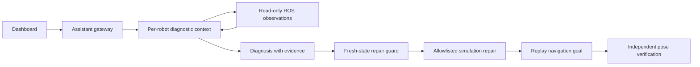

# Robot Debug Lab

English | [简体中文](README.zh-CN.md)

**An evidence-driven AI debugging lab for ROS 2 robots — no physical robot required.**

Each simulated robot gets an independent diagnostic context. An Assistant gateway coordinates reproduction, agent investigation, bounded repair, and verification against actual robot position. Model conclusions are linked to recorded observations, and a successful repair must pass the original navigation task again.

## Features

- Two real TurtleSim instances in isolated ROS namespaces: `robot_1` and `robot_2`.
- A custom Navigate Action and a deterministic 20 Hz velocity controller; the LLM is outside the real-time control loop.
- Three reproducible faults: stopped controller, misrouted velocity topic, and zero maximum speed.
- OpenAI-compatible tool calling, exercised with DeepSeek.
- Read-only investigation tools, evidence references, per-robot locks, and allowlisted repair operations.
- React dashboard with live trajectories, task cancellation, history, and JSON evidence export.
- An explicit offline rules baseline. Model failures never silently fall back to rules and masquerade as AI results.

## How it works



**Scope:** the Assistant is a programmatic coordinator. Agent contexts run concurrently on one machine; this is not a distributed scheduler. The MVP calls a model API directly. OpenFang orchestration, arbitrary source-code repair, Gazebo/Nav2, and physical robots are not integrated or validated. The current dashboard and diagnostic prompts are primarily Chinese; both English and Chinese setup documentation are provided.

## Quick start

Validated on Ubuntu 26.04 amd64 with ROS 2 Lyrical Desktop, system Python 3.14, Node.js/npm, uv, and colcon. Install these prerequisites first. ROS Python extensions require a matching system Python. This version uses Lyrical's `turtlesim_msgs`; Humble and Jazzy compatibility has not been tested.

```bash
git clone https://github.com/SeeWhy-star/robot-debug-lab.git
cd robot-debug-lab
uv venv --system-site-packages --python /usr/bin/python3 .venv
uv pip install --python .venv/bin/python -r requirements.lock
bash scripts/build.sh
npm --prefix web ci
npm --prefix web run build
# Preserve any existing local configuration.
[ -f .env ] || cp .env.example .env
chmod 600 .env
# Edit .env locally before using AI mode.
bash scripts/start.sh
```

Open <http://127.0.0.1:8765>. Stop with Ctrl+C in the server terminal. Native TurtleSim windows are hidden by default; set `RDL_NATIVE_GUI=1` to display them. The browser visualization uses actual ROS pose messages.

Set these variables in the local `.env` file:

| Variable | Meaning |
| --- | --- |
| `LLM_BASE_URL` | API root, excluding `/chat/completions` |
| `LLM_MODEL` | Provider model supporting function tool calls |
| `LLM_API_KEY` | Your own API key; never commit it |

Restart after configuration changes. The example targets DeepSeek; compatible providers can be substituted. HTTPS is required for remote model endpoints; HTTP is allowed only for loopback model servers. Leave the key empty and select rules mode for offline experiments.

## Try the debugging loop

1. Keep Robot 01 healthy and select Robot 02.
2. Inject a topic mismatch fault (`速度话题接错`).
3. Select AI mode, enable bounded automatic repair, and start diagnosis (`开始诊断`). The initial navigation timeout is the expected reproduction step.
4. Inspect tool observations, evidence references, repair events, and final position error. A successful run ends as verified (`验证通过`).
5. Repeat with zero speed or a stopped controller. Turn off automatic repair to obtain a diagnosis without applying a fix.

## Validation

```bash
source scripts/env.bash
.venv/bin/python -m pytest -q
# Requires a running server; resets simulation and calls the configured model.
.venv/bin/python scripts/acceptance.py
# Requires a running server; checks concurrency, cancellation and API guards offline.
.venv/bin/python scripts/acceptance_api.py
```

The initial real-model acceptance run passed all three fault scenarios. Independent tests cover fabricated evidence rejection, scope restrictions, stale pose rejection, restart persistence, concurrency, and cancellation. These small experiments are **not** a production accuracy benchmark. Committed acceptance samples contain simulation data, not physical robot locations.

Fresh results, process logs, and SQLite history stay in ignored `.runtime/`. Interrupted tasks are marked on restart and do not resume automatically. ROS discovery defaults to localhost on domain 93; override with `RDL_DOMAIN_ID`. Do not run duplicate instances in the same domain.

## Privacy and security

This is a **local, single-user simulation tool**, not an authenticated public service. Do not expose it through tunnels or reverse proxies. Local processes can access its task history and control API.

AI mode sends your task text and simulated ROS observations to your configured model provider. Rules mode does not call a model. Each investigation is limited to six model rounds, up to five tool calls per round, and 1,800 output tokens per request. Provider-reported token counts are recorded; monetary costs are not estimated.

Credentials are server-side only. `.env`, databases, logs, local screenshots, and ROS build outputs are excluded from Git. Review exported reports for private task text before sharing. Revoke and replace any credential disclosed in a chat, issue, screenshot, or commit. See [Security & Privacy](SECURITY.md) and the [pre-publication review](docs/security-review.md).

## Repository layout

```text
robot_debug_lab/  FastAPI, agents, workflow, ROS bridge, controller
ros_ws/src/      Custom Navigate Action interface
web/             React + TypeScript + Vite dashboard
scripts/         Build, startup, acceptance checks
tests/          Contract and behavior tests
docs/           Architecture, validation, project notes
```

Further reading: [architecture (中文)](docs/architecture.md), [validation (中文)](docs/validation.md), [project brief (中文)](docs/project-brief.md).

## License

Original project code is licensed under [MIT](LICENSE). Dependencies retain their respective licenses. Contributions should keep credentials and private run data out of patches, preserve the deterministic control boundary, and include relevant validation.
