# Robot Debug Lab

English | [简体中文](README.zh-CN.md)

An evidence-driven ROS 2 incident investigation lab built on **Gazebo Sim, Nav2 and OpenFang**.

A TurtleBot3 executes a real Nav2 goal in a repository-owned Gazebo warehouse. The walls, five racks, Shelf A, charging pad and crate are simulator entities, while Nav2 consumes a matching occupancy grid and the dashboard overlays live odometry on that same map. The lab can interrupt the guarded laser path between Gazebo's raw `/scan` and Nav2's `/scan_faulted` input. The AI never receives the injected label: it must inspect live ROS nodes, sensor rates, parameters and motion, cite recorded evidence, and request an allowlisted recovery. The original goal is then replayed and independently accepted against Gazebo odometry.

## What the AI actually does

- Deterministic code resolves simple named places and explicit coordinates without a model call.
- The deterministic path accepts only a complete atomic command; unknown, compound, or action-bearing language is delegated to the model instead of being misread as one place name.
- For complex missions, the supervisor queries the semantic scene and robot capability catalog through bounded tools and returns ordered, structured steps.
- Multi-stop requests can resolve all named places in one authoritative batch call; duplicate observations are rejected to bound tool use.
- The gateway validates cross-step invariants, including requiring charging-station arrival immediately before simulated charging.
- Unsupported intents such as pickup return no executable steps and a grounded alternative; a follow-up is replanned with the full clarification history.
- A diagnostic agent chooses read-only tools and produces a structured conclusion with real evidence IDs.
- A deterministic gateway checks fresh evidence before applying the matching allowlisted repair.
- When the stack is healthy but a reviewed semantic approach fails in execution, a separate Agent may select only a Nav2-verified alternative approach while completed and later mission steps remain unchanged.
- Nav2 remains responsible for planning and control; the model never publishes velocity commands.

Local end-to-end acceptance on 2026-10-29 completed the same laser incident in both modes. The rules baseline finished with 0 tokens and 0.1816 m final error. The OpenFang AI run produced 11 recorded events, consumed 12132 provider-reported tokens, and finished with 0.2536 m final error. See the committed [acceptance summary](docs/nav2-acceptance-results.json).

## Quick start

Validated on Ubuntu 26.04 amd64 with ROS 2 Lyrical and system Python 3.14.

```bash
uv venv --system-site-packages --python /usr/bin/python3 .venv
uv pip install --python .venv/bin/python -r requirements.lock
npm --prefix web ci
npm --prefix web run build
[ -f .env ] || cp .env.example .env
chmod 600 .env

bash scripts/install_nav2_sim.sh
bash scripts/check_nav2_sim.sh
bash scripts/start_all.sh
```

Open <http://127.0.0.1:8765>. Use `RDL_NATIVE_GUI=1 bash scripts/start_all.sh` to show Gazebo and RViz. Configure either a direct compatible model or `RDL_AGENT_BACKEND=openfang` in `.env`; see [OpenFang setup](docs/openfang.md).

Run the live incident acceptance against a running server:

```bash
.venv/bin/python scripts/acceptance_nav2.py --mode rules
.venv/bin/python scripts/acceptance_nav2.py --mode ai
.venv/bin/python scripts/acceptance_missions.py --reset
.venv/bin/python scripts/acceptance_replanning.py
.venv/bin/python scripts/evaluate_fault_matrix.py --mode both
```

## Architecture

```mermaid
flowchart LR
  UI[React dashboard] --> API[FastAPI gateway]
  API --> Nav2[Nav2 goal]
  Nav2 -->|failure| Agent[OpenFang diagnostic agent]
  Agent --> Tools[Read-only ROS tools]
  Tools --> Guard[Fresh evidence guard]
  Guard --> Repair[Restore scan forwarding]
  Repair --> Replay[Replay identical goal]
  Replay --> Odom[Gazebo odometry verdict]
```



The dashboard includes mission input, the actual 2-D Nav2 occupancy map with live warehouse telemetry, controlled fault injection, evidence timelines, rules/AI comparison, JSON export, and a separate real-source repair case. Start with `RDL_NATIVE_GUI=1 bash scripts/start_all.sh` to inspect the native 3-D Gazebo world and RViz alongside the dashboard.

A live mission acceptance covers the previous failure phrase `机器人去实体障碍箱回来后去充电`: OpenFang resolves real scene objects, the gateway binds reviewed approach poses, and Nav2 executes the resulting crate → start → charging-station mission. The same acceptance verifies that `去货架 A 拿货，然后去充电` remains a clarification with no robot run because this TurtleBot3 has no pickup capability.

A separate [live replanning result](docs/replanning-acceptance-results.json) moves the physical crate onto Shelf A's default approach. The first Nav2 attempt fails, OpenFang cites mission and route evidence, selects a server-reviewed Nav2-reachable alternative, and Gazebo independently accepts the retry.

## Development status

**Phase 1 backend is complete:** zero-token atomic routing, tool-grounded ReAct planning, an authoritative semantic scene, ordered multi-step execution, contextual clarification, capability negotiation, observable simulated charging, cancellation, and independent acceptance are implemented. Evidence-grounded recovery from a blocked semantic approach is also working end to end.

**Phase 2 has a runnable baseline:** three distinct ROS/Nav2 failures, AI-versus-rules comparison, and an automated evaluation matrix are present. Broader repeated trials and combined mission failures remain future work, alongside costmap-derived candidate generation, general conditional task graphs, restart resumption, multi-robot operation, and physical manipulation.

## Real Nav2 source case

The source case pins upstream Navigation2 commit `6794f00fb316efc2e9ede468d913021a481f57a1`. Its isolated harness compiles the actual `nav2_costmap_2d` publisher sources with ASan/UBSan and checks valid raw and grid updates, disabled layers, out-of-range bounds, empty maps, and recovery after invalid input.

```bash
bash scripts/prepare_nav2_case.sh
.venv/bin/python scripts/nav2_case.py reproduce
.venv/bin/python scripts/nav2_case.py investigate --attempts 2
```

The model can only make exact replacements in the reviewed translation unit. It cannot edit the probe. Every candidate is rebuilt and must pass all six independent scenarios. This is a component experiment, not an upstream-quality claim.

## Validation and scope

```bash
source scripts/env.bash
.venv/bin/python -m pytest -q
npm --prefix web run build
npm --prefix web audit
```

Runtime history, logs and source-case workspaces stay in ignored `.runtime/`. This is a local single-user simulation research project. It is not a production fleet scheduler, a physical-robot safety controller, or a general autonomous repair system.

See [architecture](docs/architecture.md), [project brief](docs/project-brief.md), and [security](SECURITY.md). Original project code is MIT licensed.
