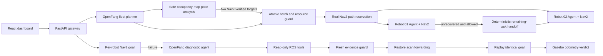

# Robot Debug Lab

English | [简体中文](README.zh-CN.md)

An evidence-driven ROS 2 incident investigation lab built on **Gazebo Sim, Nav2 and OpenFang**.

Two TurtleBot3 robots execute real, namespaced Nav2 goals in one repository-owned Gazebo warehouse. The walls, five racks, Shelf A, charging pad and crate are simulator entities, while both Nav2 stacks consume a matching occupancy grid and the dashboard overlays independent live odometry on that same map. For known incidents, the AI never receives the injected label: it must inspect live ROS nodes, sensor rates, parameters and motion, cite recorded evidence, and request an allowlisted recovery. For an unseen mechanism it may instead report `unknown_fault`, a suspected subsystem and cited evidence. A separate deterministic authorizer rechecks fresh server-side state before any repair; unsupported diagnoses are escalated without mutation.

## What the AI actually does

- Deterministic code resolves simple named places and explicit coordinates without a model call.
- The deterministic path accepts only a complete atomic command; unknown, compound, or action-bearing language is delegated to the model instead of being misread as one place name.
- For complex missions, the supervisor queries the semantic scene and robot capability catalog through bounded tools and returns ordered, structured steps.
- Multi-stop requests can resolve all named places in one authoritative batch call; duplicate observations are rejected to bound tool use.
- The gateway validates cross-step invariants, including requiring charging-station arrival immediately before simulated charging.
- Unsupported intents such as pickup return no executable steps and a grounded alternative; a follow-up is replanned with the full clarification history.
- A diagnostic agent chooses read-only tools and produces a structured conclusion with real evidence IDs. Its conclusion may be a known fault, an unknown fault with a suspected subsystem, insufficient evidence, or a healthy result.
- A deterministic gateway checks fresh evidence before applying the matching allowlisted repair. Unknown and insufficient diagnoses are never repaired automatically.
- Localization incidents are diagnosed from measured AMCL-versus-Gazebo divergence; the simulation-only repair may reseed AMCL from verified Gazebo truth before replaying the original goal.
- When the stack is healthy but a reviewed semantic approach fails in execution, a separate Agent may select only a Nav2-verified alternative approach while completed and later mission steps remain unchanged.
- Nav2 remains responsible for planning and control; the model never publishes velocity commands.
- A separate OpenFang fleet Agent reads both robots' live poses and health plus the semantic registry, then returns one structured mission per selected robot. The gateway reserves the whole batch before starting either mission and enforces the single charging-station capacity.
- For separation, balanced-coverage and rendezvous requests, a deterministic spatial tool inflates the actual Nav2 occupancy map, searches safe pose pairs, and requires `ComputePathToPose` evidence for both robots. The Agent may select the objective but cannot change or swap the tool-bound coordinates. Gazebo ground truth independently checks both final poses and their actual separation.
- Spatial results are approximate: 0.40 m candidate sampling, at most 12 pairs and a bounded live Nav2 search do not prove a global optimum. Distance is Euclidean. Coverage minimizes the worst nearest-robot distance over safe samples and means two static positions, not completed patrol or inspection. Dynamic obstacles remain Nav2's responsibility; paired goals cannot be handed off to one robot.
- If one fleet mission remains failed after its own recovery policy, an explicit deterministic handoff policy can transfer only the portable unfinished suffix to the verified peer. The source failure remains visible and the handoff is accepted independently against Gazebo.
- Before each fleet navigation, the deterministic gateway previews the actual Nav2 path and atomically reserves its spatial footprint. Conflicting routes wait, disjoint routes remain parallel, and no robot can hold only part of a route while waiting for another part.
- Route reservations have a bounded wait. An expired wait is recorded as a distinct, reassignable failure, after which the verified peer may execute the portable unfinished goal as a separately accepted run.
- Saved fleet plans can be replayed in AI and rules modes only after semantic targets are revalidated against the current scene registry. This keeps assignments identical in controlled comparisons and rejects stale poses or model-invented coordinates.

Local end-to-end acceptance on 2026-10-29 completed the same laser incident in both modes. The rules baseline finished with 0 tokens and 0.1816 m final error. The OpenFang AI run produced 11 recorded events, consumed 12132 provider-reported tokens, and finished with 0.2536 m final error. See the committed [acceptance summary](docs/nav2-acceptance-results.json).

The frozen-prompt unseen-fault experiment disables AMCL's real `tf_broadcast` parameter while AMCL and `bt_navigator` remain active. Across two trials per strategy, rules localized the TF subsystem 0/2 times, an LLM without investigation tools did so 1/2 times, and the tool-using LLM did so 2/2 times. The no-tools model also requested one incorrect known repair, which the deterministic authorizer denied; no incorrect repair executed. This is a six-run controlled demonstration, not a general accuracy claim. The tool set already included a generic TF inspection tool, and the OpenFang endpoint exposed only the model alias `default`. See the [experiment report](docs/experiments/unseen-transform-ablation.md) and [raw JSON](docs/experiments/unseen-transform-ablation.json).

## Quick start

Validated on Ubuntu 26.04 amd64 with ROS 2 Lyrical and system Python 3.14.

```bash
uv venv --system-site-packages --python /usr/bin/python3 .venv
uv pip install --python .venv/bin/python -r requirements.lock
npm --prefix web ci
npm --prefix web run build
[ -f .env ] || cp .env.example .env
chmod 600 .env

bash scripts/install_nav2_sim.sh
bash scripts/check_nav2_sim.sh
bash scripts/start_all.sh
```

Open <http://127.0.0.1:8765>. Use `RDL_NATIVE_GUI=1 bash scripts/start_all.sh` to show Gazebo and RViz. Configure either a direct compatible model or `RDL_AGENT_BACKEND=openfang` in `.env`; see [OpenFang setup](docs/openfang.md).
Stop the complete project stack from any terminal with `bash scripts/stop_all.sh`. The command validates process ownership and command lines before stopping the launcher, dashboard, project-local OpenFang, Gazebo and Nav2; `--dry-run` only shows the matching processes.

If a shell proxy incorrectly captures loopback traffic, fix its local bypass or use a one-run override without changing project files:

```bash
env -u ALL_PROXY -u all_proxy \
  NO_PROXY=127.0.0.1,localhost no_proxy=127.0.0.1,localhost \
  RDL_NATIVE_GUI=1 bash scripts/start_all.sh
```

Run the live incident acceptance against a running server:

```bash
.venv/bin/python scripts/acceptance_nav2.py --mode rules
.venv/bin/python scripts/acceptance_nav2.py --mode ai
.venv/bin/python scripts/acceptance_missions.py --reset
.venv/bin/python scripts/acceptance_replanning.py
.venv/bin/python scripts/acceptance_combined_recovery.py --fault navigator_inactive
.venv/bin/python scripts/acceptance_fleet.py --reset
.venv/bin/python scripts/acceptance_fleet_handoff.py --output docs/fleet-handoff-results.json
.venv/bin/python scripts/acceptance_fleet_traffic.py --output docs/fleet-traffic-results.json
.venv/bin/python scripts/acceptance_spatial_fleet.py --output docs/spatial-fleet-acceptance-results.json
.venv/bin/python scripts/acceptance_spatial_fleet.py --objective rendezvous --output docs/spatial-rendezvous-results.json
.venv/bin/python scripts/acceptance_spatial_fleet.py --objective balanced_coverage --output docs/spatial-coverage-results.json
.venv/bin/python scripts/evaluate_fleet_matrix.py --scenario all --mode both --trials 3 --resume --output docs/fleet-evaluation-results.json
.venv/bin/python scripts/evaluate_fault_matrix.py --mode both
.venv/bin/python scripts/evaluate_mission_faults.py --fault all --mode both --trials 3 --resume
# Reproduce only the fourth localization mechanism
.venv/bin/python scripts/evaluate_fault_matrix.py --fault localization_drift --mode both
# Reproduce the unseen transform mechanism without an Agent, then run the small ablation
.venv/bin/python scripts/reproduce_transform_fault.py --trials 3
.venv/bin/python scripts/evaluate_diagnostic_ablation.py --trials-per-strategy 2
```

## Architecture



The light dashboard puts the actual 2-D Nav2 occupancy map, both robots and route reservations next to natural-language tasks and controlled fault injection. Run details render the contract-v2 phase progression, cited evidence, diagnostic recommendation, deterministic authorization, Nav2 attempts and Gazebo verdict as separate records. A labeled-only experiment panel compares rules, an LLM without tools and a tool-using LLM while showing the small sample size and excluded demo runs. Legacy mission and fleet events remain visible through generic timeline cards. Start with `RDL_NATIVE_GUI=1 bash scripts/start_all.sh` to inspect the native 3-D Gazebo world and RViz alongside the dashboard; 3-D Gazebo is not embedded in the page.

A live mission acceptance covers the previous failure phrase `机器人去实体障碍箱回来后去充电`: OpenFang resolves real scene objects, the gateway binds reviewed approach poses, and Nav2 executes the resulting crate → start → charging-station mission. The same acceptance verifies that `去货架 A 拿货，然后去充电` remains a clarification with no robot run because this TurtleBot3 has no pickup capability.

A separate [live replanning result](docs/replanning-acceptance-results.json) moves the physical crate onto Shelf A's default approach. The first Nav2 attempt fails, OpenFang cites mission and route evidence, selects a server-reviewed Nav2-reachable alternative, and Gazebo independently accepts the retry.

Faults can also be armed for the Nth real navigation call of an ordered mission without exposing that schedule through Agent tools. The committed [mid-mission fault matrix](docs/mission-fault-evaluation-results.json) contains three trials across three mechanisms and AI/rules recovery: all 18 real missions identified the fault, preserved S1, recovered S2, finished later steps, and made zero wrong repairs. Each trial generates one model plan and reuses that server-validated plan for its six controlled comparisons. AI recovery averaged 27.738–46.804 seconds and 12,094–20,099 diagnosis tokens depending on mechanism; individual token use still varied substantially.

The [combined recovery acceptance](docs/combined-recovery-results.json) exercises two failures on the same mission step. The diagnostic Agent first identifies and repairs an inactive Nav2 lifecycle. Replaying the identical Shelf A target then encounters the physical crate. Only after a fresh deterministic stack check reports healthy may the route Agent inspect mission and Nav2 path evidence, select the reviewed `southwest` approach, and continue the waiting and idle steps. The live run completed all five steps with 0.182 m Gazebo odometry error.

A fourth mechanism now corrupts AMCL through the real `/initialpose` interface while Gazebo odometry remains the acceptance oracle. The [direct AI/rules comparison](docs/localization-drift-results.json) identified and recovered both runs with zero wrong repairs. The [mid-mission comparison](docs/localization-mission-results.json) reused one model plan, preserved S1, recovered S2, and completed all later steps in both modes.

## Development status

**Phase 1 backend is complete:** zero-token atomic routing, tool-grounded ReAct planning, an authoritative semantic scene, ordered multi-step execution, contextual clarification, capability negotiation, observable simulated charging, cancellation, and independent acceptance are implemented. Evidence-grounded recovery from a blocked semantic approach is also working end to end.

**Phase 2 backend is complete:** four allowlisted ROS/Nav2 failures, AI-versus-rules comparison, mid-mission recovery, automated evaluation, and combined system-plus-route recovery are implemented. A fifth, non-allowlisted transform-publication failure exercises unknown-fault diagnosis and deterministic escalation. The original three-mechanism matrix passed 18 live runs; localization drift additionally passed direct and ordered-mission AI/rules comparisons. The unseen-fault ablation is intentionally small and does not establish general diagnostic accuracy. Costmap-derived candidate generation, general conditional task graphs, restart resumption, and physical manipulation remain later extensions.

**Phase 3 backend is complete:** two physical Gazebo robot entities now run independent namespaced sensor, TF, AMCL and Nav2 stacks in one shared world. An OpenFang fleet Agent queries live fleet state and semantic destinations, proposes assignments, and the deterministic workflow atomically starts both missions. Per-robot faults remain isolated, portable unfinished steps can be handed to the verified peer, and crossing Nav2 routes use bounded full-route reservations. A reservation timeout is recorded and can trigger deterministic reassignment instead of waiting forever. The committed [repeatable fleet matrix](docs/fleet-evaluation-results.json) passed 36/36 live cases: six scenarios, three trials, and AI/rules comparison using one validated plan per scenario and trial. It covers parallel work, crossing traffic, timeout handoff, scan recovery, lifecycle recovery and unrepaired-fault handoff, with independent Gazebo acceptance, model tools on every AI fault run, zero wrong repairs and zero global traffic fallbacks. Three subsequent live spatial acceptances verified [maximum separation](docs/spatial-fleet-acceptance-results.json), [safe rendezvous](docs/spatial-rendezvous-results.json), and [balanced static coverage](docs/spatial-coverage-results.json). OpenFang selected the correct map-analysis objective for each natural-language request; all six robot runs verified, and Gazebo measured final separations of 8.220 m, 0.995 m, and 3.680 m respectively. Time-aware MAPF, fleets larger than two robots and physical-fleet safety remain research extensions outside this phase.

**Dashboard refresh is complete:** the previous single-file interface is split into typed scene, run-detail and experiment components with a light operations-console layout. It consumes the real contract-v2 state and metrics APIs rather than mock data. Native Gazebo/RViz remain separate windows; browser-embedded 3-D visualization is still future work.

## Real Nav2 source case

The source case pins upstream Navigation2 commit `6794f00fb316efc2e9ede468d913021a481f57a1`. Its isolated harness compiles the actual `nav2_costmap_2d` publisher sources with ASan/UBSan and checks valid raw and grid updates, disabled layers, out-of-range bounds, empty maps, and recovery after invalid input.

```bash
bash scripts/prepare_nav2_case.sh
.venv/bin/python scripts/nav2_case.py reproduce
.venv/bin/python scripts/nav2_case.py investigate --attempts 2
```

The model can only make exact replacements in the reviewed translation unit. It cannot edit the probe. Every candidate is rebuilt and must pass all six independent scenarios. This is a component experiment, not an upstream-quality claim.

## Validation and scope

```bash
source scripts/env.bash
.venv/bin/python -m pytest -q
npm --prefix web run build
npm --prefix web audit
```

Runtime history, logs and source-case workspaces stay in ignored `.runtime/`. This is a local single-user simulation research project. It is not a production fleet scheduler, a physical-robot safety controller, or a general autonomous repair system.

See [architecture](docs/architecture.md), [project brief](docs/project-brief.md), and [security](SECURITY.md). Original project code is MIT licensed.
