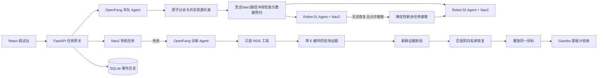

# Robot Debug Lab

[English](README.md) | 简体中文

一个基于 **Gazebo Sim + Nav2 + OpenFang** 的 ROS 2 多机器人任务、故障诊断与恢复工作台。两台机器人在同一个真实仿真世界中运行各自独立的传感器、TF、AMCL和Nav2；AI负责复杂任务分工、选择调查工具和组织现场证据，确定性程序负责原子分派、权限、白名单动作和Gazebo独立验收。

## 核心案例

仓库机器人从起点前往货架 A `(2.0, 0.5)`。仓库墙体、5 组货架、货架 A、充电站和障碍箱都存在于 Gazebo 世界文件中；后端语义注册表记录实体中心和经过审核的安全接近点，Nav2 不会把障碍物中心当成目标。只有整句能够被完整识别为一个已知地点或明确坐标时，才走 0 token 的确定性路径；未知、复合或带额外动作的表达交给模型查询场景和机器人能力，不能再把整句话误当成地点名称。

例如“机器人去实体障碍箱回来后去充电”会由 OpenFang 一次性核验多个地点，生成并执行“障碍箱安全接近点 → 返回起点 → 充电站 → 明确标注的仿真充电”。网关还会检查步骤间业务约束：仿真充电必须紧跟在到达充电站之后，漏掉导航或把充电放在其他地点的计划会退回同一 Agent 修正，不会下发。“去货架 A 拿货”则会查询能力目录；当前 TurtleBot3 没有抓取技能，因此返回零执行步骤和可用替代方案，不会把拿货偷偷替换成等待或声称完成。用户接受替代方案后，Agent 会结合前后两轮对话重新规划。

故障实验包含四种不同机制：`/scan → /scan_faulted` 中断、Nav2 lifecycle 整组 inactive、controller 前后向速度上限同时为零，以及 AMCL 位姿与 Gazebo 真值分离。AI 看不到注入标签，只能调用只读工具检查 ROS 节点、话题速率、lifecycle、参数、运动状态和两套位姿的实测偏差。网关要求原因与现场证据一致后，才执行对应的白名单修复并重放相同目标。成功与否由 Gazebo 里程计误差 `< 0.35 m` 判定。

本机 2026-10-29 的真实验收结果（摘要见 [验收记录](docs/nav2-acceptance-results.json)）：

| 模式 | 结果 | 修复前误差 | 修复后误差 | 事件 | 模型 tokens |
| --- | --- | ---: | ---: | ---: | ---: |
| 规则基线 | verified | 3.9545 m | 0.1816 m | 7 | 0 |
| OpenFang AI | verified | 3.8998 m | 0.2536 m | 11 | 12132 |

规则模式用于证明故障装置和修复链路本身可靠；AI 模式用于证明模型确实参与调查。模型不直接发布速度，也不能执行 shell、任意参数修改或任意代码。

前三种故障的三轮 AI/规则矩阵见[故障评测结果](docs/fault-evaluation-results.json)。第四种定位漂移也完成了独立 AI/规则对照：两种模式均正确识别并恢复原任务，错误修复为 0，详见[定位漂移结果](docs/localization-drift-results.json)。

任务级恢复另有一个真实动态场景：后端通过 Gazebo `set_pose` 把实体 `temporary_crate` 移到货架 A 的默认接近点。首次 Nav2 导航必须实际失败；程序先用新鲜 ROS 状态排除已知系统故障，然后重规划 Agent 读取任务进度和经过审核的候选接近点，只能选择 Nav2 实测可达的替代点。网关保留已完成和后续步骤、记录计划版本，再由 Gazebo 验收重试结果。Agent 看不到场景注入标签，也不能编造坐标。真实结果见[重规划验收记录](docs/replanning-acceptance-results.json)。

故障现在也能在复杂任务执行到第 N 次真实导航时触发。触发计划只存在于确定性实验装置中，不会出现在 Agent 的 ROS 工具结果里。2026-10-30 使用“障碍箱旁边 → 起点 → 充电站 → 等待”完成了 3 轮、3 种故障、AI/规则两种恢复模式，共 18 次真实任务：故障识别率和原任务恢复率均为 100%，每次都保留 S1、恢复 S2 并继续后续步骤，错误修复总数为 0。三轮分别只生成一次复杂计划，轮内六项复用同一份后端验证计划。AI 平均恢复时间为 27.738–46.804 秒，规则为 21.167–37.409 秒；AI 诊断平均消耗 12,094–20,099 tokens，且个别运行存在明显波动。完整数据见[任务中途故障矩阵](docs/mission-fault-evaluation-results.json)。

2026-10-31 又完成了同一步组合故障验收：任务在前往货架 A 时先遇到 `navigator_inactive`，诊断 Agent 用 ROS 证据选择 lifecycle 白名单修复；相同目标重放后又被真实 `temporary_crate` 阻塞。程序重新确认导航栈健康后才允许路线 Agent 查询任务状态和 Nav2 路径，选择货架 A 的 `southwest` 接近点，并继续执行等待和 idle。5/5 步完成，Gazebo 最终位置误差 0.182 m；详见[组合恢复记录](docs/combined-recovery-results.json)。

定位漂移还通过了复杂任务中途验收：AI 与规则复用同一个模型计划，在第二次真实导航前触发 AMCL 偏置；两种模式都保留 S1、恢复 S2 并继续完成 S3/S4，错误修复为 0。AI 使用现场 AMCL/Gazebo 偏差完成诊断，没有降级为规则结果。详见[定位漂移任务结果](docs/localization-mission-results.json)。

## 开发阶段

**第一阶段后端已完成。** 当前具备简单任务零模型解析、复杂任务 ReAct 规划、统一语义场景、多步骤顺序执行、澄清续接、能力缺口协商、可观察仿真充电、取消和最终验收。额外完成了基于真实 Gazebo 障碍与 Nav2 路径证据的受限任务重规划。

**第二阶段后端已完成。** 四种机制不同的 ROS/Nav2 故障、AI/规则对照、复杂任务中途恢复、自动评测和“系统修复后同一步再做路线恢复”的组合案例均已落地。定位漂移使用真实 `/initialpose` 改变 AMCL 状态，并以 Gazebo 真值重新播种作为仿真专用白名单修复。动态代价地图候选生成、任意条件任务图、重启续跑和实体取放仍属于后续扩展。

**第三阶段后端已完成。** Gazebo中现在有两台实体TurtleBot3，各自使用`/robot_1`和`/robot_2`命名空间运行独立雷达、里程计、TF、AMCL和Nav2。车队OpenFang Agent查询实时车队状态与统一语义地点，输出结构化分工；后端执行原子分派、唯一充电站约束、真实Nav2整路预约和可审计的失败任务接替。路线等待有明确上限，超时会形成独立失败记录，再由已经通过验收的机器人接替可迁移目标，不会无限等待。提交的[可重复车队评测矩阵](docs/fleet-evaluation-results.json)完成6个场景、3轮、AI/规则两种模式，共36个真实用例，全部通过：并行执行、交叉交通、等待超时接替、雷达链路恢复、Nav2 lifecycle恢复和未修复故障接替。每个场景每轮只生成一份经过验证的模型计划供两种模式共同重放；全部结果使用Gazebo独立验收，AI故障运行均调用模型调查工具，错误修复和全局路线降级均为0。带时间维度的MAPF、两台以上车队和实体机器人安全层属于本阶段之外的研究扩展。

## 系统结构



网页有四个清晰区域：

1. **自然语言任务**：简单目标走确定性语义表；复杂指令通过真实场景工具形成有序步骤；历史下拉框只用于查看记录。
2. **运行现场与故障实验**：显示 Gazebo 里程计轨迹、当前活动目标、雷达速率和 AMCL/Gazebo 偏差，支持四种机制不同的故障。
3. **AI 诊断与证据**：对比 AI 和规则基线，查看每次工具调用、证据引用、修复和复测结果。
4. **真实源码案例**：隔离复现 Nav2 #5710，要求 AI 生成受限 C++ 补丁、重新编译并通过独立测试。

## 安装与启动

已验证环境：Ubuntu 26.04 amd64、ROS 2 Lyrical、系统 Python 3.14、Node.js/npm、uv。

```bash
uv venv --system-site-packages --python /usr/bin/python3 .venv
uv pip install --python .venv/bin/python -r requirements.lock
npm --prefix web ci
npm --prefix web run build
[ -f .env ] || cp .env.example .env
chmod 600 .env

# 一次性安装 Nav2、Gazebo Sim 和 TurtleBot3 依赖
bash scripts/install_nav2_sim.sh
bash scripts/check_nav2_sim.sh

# 启动网页、Gazebo/Nav2 和 OpenFang（若 .env 选择 openfang）
bash scripts/start_all.sh
```

打开 <http://127.0.0.1:8765>。网页“运行现场”显示的是 **Nav2 实际占据栅格的 2D 导航视图**，不是 3D 渲染图。`Ctrl+C` 会回收同一终端启动的服务；从其他终端可运行`bash scripts/stop_all.sh`停止整套项目，`--dry-run`只显示经过用户、工作目录和命令行校验的匹配进程。使用 `RDL_NATIVE_GUI=1 bash scripts/start_all.sh` 可同时查看 Gazebo 原生 3D 世界和 RViz 导航数据。

场景真值文件是 [`simulation/worlds/rdl_warehouse.sdf.xacro`](simulation/worlds/rdl_warehouse.sdf.xacro)，Nav2 地图是 [`simulation/maps/rdl_warehouse.yaml`](simulation/maps/rdl_warehouse.yaml)。两者必须同步；地图预览由 `simulation/generate_warehouse_map.py` 生成。

AI 模式需要在 `.env` 配置直连模型，或设置 `RDL_AGENT_BACKEND=openfang`。OpenFang 首次安装见 [接入说明](docs/openfang.md)。密钥只放本地 `.env`，不要提交。

## 推荐体验流程

1. 点击“重置”，等待 Robot 01 在线。
2. 输入“去充电站”，确认走确定性语义表且模型 tokens 为 0。
3. 输入“机器人去实体障碍箱回来后去充电”，查看 Agent 场景工具和有序步骤，再观察 Gazebo/Nav2 真实执行。
4. 输入“去货架 A 拿货，然后去充电”，确认系统只提出替代方案，没有分派机器人任务；可继续回复“按第一个替代方案，只去货架 A”。
5. 点击“注入故障”，确认原始雷达仍有数据，而 Nav2 雷达输入变为 0 Hz。
6. 选择“模型 AI”，勾选限定修复，点击“开始诊断”，在时间线查看证据、修复和同目标复测。
7. 切换“规则基线”重复实验，对比事件数、结论和 token 消耗。
8. 在自然语言任务中选择“车队协同 Agent”，输入“让更合适的一台去货架A，另一台去充电站并等待5秒”，查看模型读取实时车队状态、生成分工并同时执行。保留“允许健康机器人接替”勾选项可在单机无法完成时转交剩余的可迁移步骤；原失败记录仍会保留。

自动验收命令会重置仿真并执行完整故障闭环：

```bash
.venv/bin/python scripts/acceptance_nav2.py --mode rules
.venv/bin/python scripts/acceptance_nav2.py --mode ai
.venv/bin/python scripts/acceptance_missions.py --reset
.venv/bin/python scripts/acceptance_replanning.py
.venv/bin/python scripts/acceptance_combined_recovery.py --fault navigator_inactive
.venv/bin/python scripts/acceptance_fleet.py --reset
.venv/bin/python scripts/acceptance_fleet_handoff.py --output docs/fleet-handoff-results.json
.venv/bin/python scripts/acceptance_fleet_traffic.py --output docs/fleet-traffic-results.json
.venv/bin/python scripts/evaluate_fleet_matrix.py --scenario all --mode both --trials 3 --resume --output docs/fleet-evaluation-results.json
.venv/bin/python scripts/evaluate_fault_matrix.py --mode both
.venv/bin/python scripts/evaluate_mission_faults.py --fault all --mode both --trials 3 --resume
# 单独复现第四种定位故障
.venv/bin/python scripts/evaluate_fault_matrix.py --fault localization_drift --mode both
```

## 真实 Nav2 源码案例

源码案例固定上游 Navigation2 提交，使用 ASan/UBSan 复现 `nav2_costmap_2d` 越界问题。AI 只能对审核过的 C++ 翻译单元做精确文本替换；每个候选都会重新编译并运行 6 个独立场景。详情与命令见 [英文 README](README.md#real-nav2-source-case) 和网页的“真实源码案例”。

## 验证

```bash
source scripts/env.bash
.venv/bin/python -m pytest -q
npm --prefix web run build
npm --prefix web audit
```

`.runtime/` 保存仿真日志、SQLite 历史和源码案例产物，不会提交。项目是双机器人本地仿真研究原型，不代表实体机器人安全系统、生产级调度集群或通用自动修复能力。

更多内容：[架构与边界](docs/architecture.md)、[项目表达](docs/project-brief.md)、[OpenFang](docs/openfang.md)。
