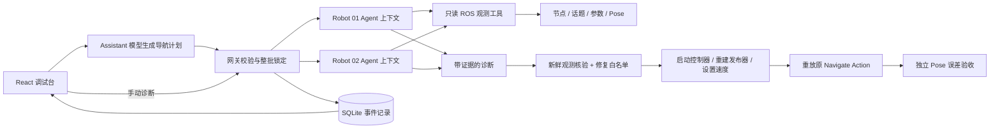

# Architecture

## 调试闭环

网关为每个机器人持有互斥锁，同一机器人不能同时运行注入、导航和诊断；不同机器人可以并行。Agent 不接收注入的故障标签，只有真实观测与用户描述。每次调查使用新的消息上下文，工具的机器人范围由服务端绑定。inspect_peer 只读对照机器人。

## 状态与控制

手动诊断从 queued → reproducing → investigating → repairing → validating 进入 verified/unresolved。自然语言任务先执行 navigating，成功直接 verified，失败再 investigating；也可能 diagnosed、failed、canceled。重启将未结束任务和计划标记为 interrupted。

控制器独立运行，不受模型推理延迟影响；ROS Action 支持超时和取消。手动诊断复现目标 (8,8)，自然语言任务使用校验后的自定义坐标；修复后重放同一目标。网关要求实际 Pose 新鲜且距离小于 0.22，不能凭模型或控制器自报成功认定验收通过。

三个修复动作全部预定义。模型仅提议原因，网关再次检查节点和参数与原因一致，才执行动作。command_topic 启动时生效，需要重建控制器；max_speed 支持动态修改。没有任意 shell、文件写入或任意 ROS 参数修改工具。

SQLite 保存事件、证据、token 用量和验收结果。SSE 推送本地视图；未实现多用户、租户权限、跨机器队列和任务租约。进程监督器监控服务父进程，服务退出后回收仿真子进程；ROS 桥接禁用全局信号处理，退出由 Web 服务负责。

## 模型与 OpenFang

默认兼容层实现 OpenAI 风格 `/chat/completions` + function tools。新增 `RDL_AGENT_BACKEND=openfang` 使用官方 REST Agent 创建、消息、删除接口，通过 JSON 消息协议请求本地只读工具。每机器人拥有独立本地实例，每次调查创建新的远端会话。详见 [接入步骤、验证范围与限制](openfang.md)。

当前适配器已覆盖模拟接口契约测试，并完成 OpenFang 0.6.9 + DeepSeek 的三类故障和单次自然语言导航规划真实验收，见 [记录](openfang-validation.md) 与 [Assistant](assistant.md)。后续可升级原生 MCP 工具接入和多轮任务规划；保留 ROS 网关的执行边界、互斥锁和独立验收。

## 下一阶段

1. 从 TurtleSim 升级到 Gazebo + Nav2，加入 TF、QoS、生命周期等真实故障。
2. 为每个 Agent 提供独立进程、心跳和任务租约，支持跨主机机器人。
3. 引入运行日志检索、ROS 教程知识检索；当前尚未把教程接入 RAG。
4. 代码修复只在隔离工作区生成补丁，并要求测试验证及用户审阅。
5. 实体机器人接入需另设硬件急停、速度/区域限制和设备身份；本项目的浏览器取消按钮不是硬件急停。

本地 Host + 会话令牌用于限制浏览器误调用，不构成多用户认证。默认仅监听 127.0.0.1，不应直接暴露到公网。
